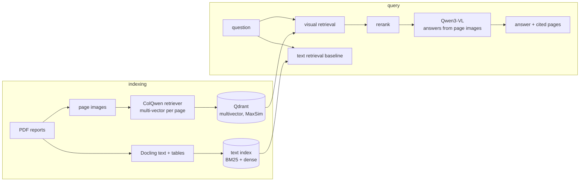

# Roadmap

> Ask questions over annual reports full of tables and charts. Retrieval searches page
> images directly instead of OCR text, and answers point to the exact page they came from.

Status: **planned** · no milestone started. A milestone is finished when its heading ends in "(done)".

## What it does

- Index a collection of PDF annual reports (German and English) as page images.
- A question like "How did Siemens' free cash flow change from 2024 to 2025?" retrieves the
  most relevant pages by visual similarity, including pages where the answer is in a chart.
- A vision-language model reads those page images and answers, citing page numbers, with the
  cited page shown next to the answer.
- The same questions run through a classic OCR-text RAG pipeline, so the README shows where
  each approach wins.

## What it proves

- Multimodal retrieval with late-interaction models (ColPali family), which is current practice
  for document-heavy companies (finance, insurance, legal, publishing).
- Retrieval engineering: multi-vector indexes, index size vs accuracy trade-offs, reranking.
- Evaluation of retrieval and answers separately, on a public benchmark and on your own
  labelled set.
- Fine-tuning a retriever for a domain and a language (German financial documents).

Distinct from car-agent-harness: no agent and no tools. This repo is about retrieval quality,
measured carefully.

## Architecture



## Stack and why

| Need | Choice | Why |
|---|---|---|
| Visual retriever | **ColQwen** family (late interaction over page-image patches) | current state of the art for visual document retrieval; checkpoints are in their 3.5 generation |
| Vector store | **Qdrant** with multivector + MaxSim | native support for ColBERT-style multi-vectors; runs in-process for the demo |
| Answer model | **Qwen3-VL** (small/medium variant) | strong on charts and tables, open weights, fine-tunable |
| Text baseline | **Docling** for parsing, BM25 + a dense embedding model | fair baseline: good parsing, hybrid search |
| Retriever fine-tune | `colpali-engine` training code, LoRA | German finance pages are under-represented in public training data |
| Benchmark | **ViDoRe V3** (+ V2 subsets) | current public benchmark for retrieval and RAG on real-world documents |
| Tracking | MLflow | retrieval metrics per index variant |
| Serving | vLLM for the VLM in the production path; transformers on ZeroGPU for the demo | |
| UI | Gradio | page thumbnails with highlights, embeds in the website |

## Data

- About 30 to 50 public annual reports of DAX companies (2023-2025), German and English
  editions where both exist. Public documents, stored with DVC.
- Own evaluation set: about 150 questions with gold page numbers and short answers, split into
  text-only, table, chart and multi-page questions, in both languages.
  Write about 50 by hand, generate more with a VLM from sampled pages, then review every one.
- ViDoRe V3 for comparability with published numbers.

## Evaluation

| Metric | Measures |
|---|---|
| nDCG@5, Recall@1/5 | retrieval quality (did the right page come back?) |
| Answer accuracy (exact / judged) | did the VLM answer correctly given retrieved pages? |
| Citation precision | are the cited pages the ones that contain the answer? |
| Faithfulness | every number in the answer appears on a cited page |
| Index size, query latency | cost side of the trade-off |

Results broken down by question type (text / table / chart) and language. That breakdown is the
main finding of the project.

## Milestones

### M0 - Skeleton
uv, CLAUDE.md harness, CI, DVC, PDF download + page rendering script, eval set format and
validator. **Exit:** reports downloaded and rendered reproducibly.

### M1 - Two baselines
Text RAG (Docling + hybrid search) and visual RAG (ColQwen + Qdrant) on the same corpus, both
evaluated on retrieval metrics, MLflow logging.

### M2 - Answers with citations
Qwen3-VL answers from top-k pages, citation and faithfulness checks, answer accuracy on the
own set and ViDoRe V3.

### M3 - Efficiency
Shrink the multi-vector index (token pooling, binary or scalar quantisation), measure size vs
nDCG, add a reranking stage, report the best trade-off.

### M4 - Domain fine-tune
LoRA fine-tune of the retriever on German financial pages (synthetic queries from page images,
hard negatives from the same report), before/after on the German slice.

### M5 - Demo and deployment
Gradio app with a pre-built index, Docker images, Helm chart (API + Qdrant + vLLM), Modal
endpoint for the VLM.

## Demo and hosting

| Level | What | Cost |
|---|---|---|
| Always works | website page: video, comparison tables, example Q&A with page images | $0 |
| Live | Gradio Space on ZeroGPU with a pre-built index of ~20 reports, Qdrant in-process | $0, or $9/month for HF PRO quota |
| Production path | vLLM VLM endpoint on Modal (scale to zero), API + Qdrant in Docker | within Modal free credits for demo use |

Cached answers for 10 showcase questions are bundled, so the demo still shows results if the
GPU quota is used up.

## Compute budget (estimate)

- Indexing 50 reports (about 10,000 pages) with ColQwen: one GPU session of an hour or two.
- Retriever LoRA fine-tune: a few GPU hours on a single 24-48 GB card.
- Rough one-off total: $10-30 on Modal, or free on Kaggle with patience.

## CI/CD

- PR: lint, mypy, unit tests, retrieval regression on a 5-report mini index (CPU, small
  checkpoint), eval set validation.
- Main: build images, push to GHCR, update the Space.
- Manual workflow: full evaluation on GPU (Modal), results committed as a report.

## Repo layout

```
src/vdrag/{ingest,render,index,retrieve,rerank,answer,evaluate}.py
evals/{questions.jsonl,run.py}
train/retriever_lora.py
app/gradio_app.py
deploy/{docker,helm}/
CLAUDE.md  Makefile  docs/adr/
```

## Risks

- Multi-vector indexes are large (hundreds of vectors per page). Mitigation: M3 is built
  around exactly this.
- Annual report licences: link to and download from the source instead of redistributing PDFs.
- VLM hallucinating numbers from charts. Mitigation: faithfulness check against OCR text of the
  cited page.
